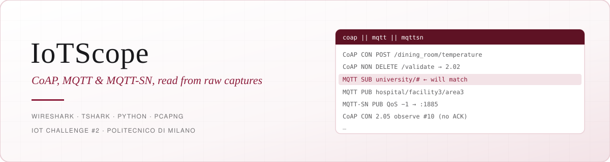
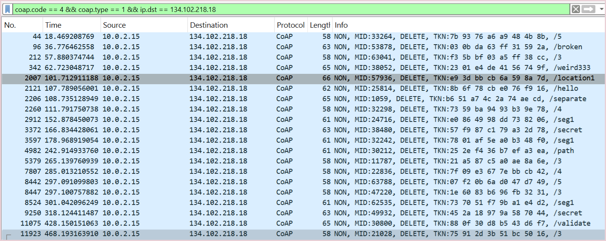
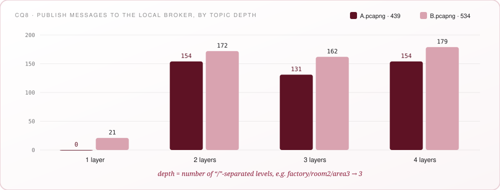
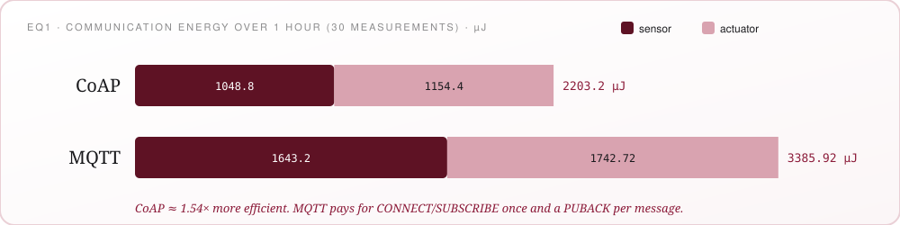

<p align="center">
  
</p>

<p align="center">
  
  
  
  
  
</p>

<p align="center"><i>
Two packet captures and eight questions, each answered with a filter you can rerun<br>
and a justification that checks the semantics of the protocol, not just a field value.
</i></p>

---

## ✦ Contents

- [The task](#-the-task)
- [Answers at a glance](#-answers-at-a-glance)
- [A.pcapng: CoAP & MQTT-SN](#-apcapng-coap--mqtt-sn)
- [B.pcapng: MQTT brokers, wills and retained messages](#-bpcapng-mqtt-brokers-wills-and-retained-messages)
- [CQ8: local broker usage across both captures](#-cq8-local-broker-usage-across-both-captures)
- [Part 2: CoAP vs MQTT energy](#-part-2-coap-vs-mqtt-energy)
- [Run the scripts](#-run-the-scripts)
- [Repository layout](#-repository-layout)

---

## ✦ The task

Two Wireshark captures of a lab IoT network: **`A.pcapng`** (CoAP against `coap.me` and a local server, plus MQTT-SN) and
**`B.pcapng`** (MQTT against a local broker and public HiveMQ instances). The questions look like simple filters, but most of them
hinge on a protocol detail. A successful response does not mean the operation worked. A retransmission is not a new notification.
A will message only reaches subscribers **on the same broker**.

Wireshark was used for interactive inspection and manual checks of single exchanges. **tshark** and Python scripts handled
systematic, reproducible field extraction, and separate `verify_*.py` scripts recompute the trickier answers.

---

## ✦ Answers at a glance

| | Question | Answer | Capture |
|:--|:--|:--:|:--:|
| **CQ1** | NON DELETE requests to `coap.me` | **20** | A |
| **CQ1a** | …that received a successful response | **1** (MID 30800) | A |
| **CQ1b** | …that actually achieved the deletion | **0** | A |
| **CQ2** | Local resources with X = Y unsuccessful unique CON POST / PUT, X > 0 | **1** | A |
| **CQ3a** | Separate observe notifications for `/dining_room/temperature`, no retransmissions | **10** | A |
| **CQ3b** | …of which useless | **5** | A |
| **CQ4** | MQTT-SN messages received by clients from the broker on `:1885` | **0** | A |
| **CQ5** | Subscribers receiving a last will through a wildcard subscription | **1** | B |
| **CQ6a** | Clients erasing a retained value on public HiveMQ | **5** | B |
| **CQ6b** | …with a client ID longer than 7 bytes | **2** | B |
| **CQ7** | SUBSCRIBEs to the local broker with ≥ 2 wildcards | **9** | B |
| **CQ8a / b** | PUBLISH messages to the local broker | **439 / 534** | A / B |

---

## ✦ A.pcapng: CoAP & MQTT-SN

### CQ1: a 2.02 response did not mean the resource was deleted

```wireshark
coap.type == 1 && coap.code == 4 && ip.dst == 134.102.218.18     # NON · DELETE · coap.me
```

Of the **20** NON DELETE requests, 19 got `4.05 Method Not Allowed`. One, `/validate` (MID 30800, token `880f30d8…`), got
`2.02 Deleted`, so **CQ1a = 1**. But a later `GET /validate` (frame 11363) returns `2.05 Content`: the resource was still there.
**No request achieved the deletion**, so **CQ1b = 0**. Requests and responses were matched by **token**, because NON exchanges have no ACK to pair by MID.

<p align="center">
  
</p>

### CQ2: equal unsuccessful POST and PUT per resource

```wireshark
coap.type == 0 && coap.code == 2 && ip.dst == 127.0.0.1          # CON POST
coap.type == 0 && coap.code == 3 && ip.dst == 127.0.0.1          # CON PUT
coap && ip.src == 127.0.0.1 && coap.code >= 128                  # 4.xx / 5.xx responses
```

CON requests pair with their ACK **by MID**. A request counts as unsuccessful only if its ACK carries 4.xx/5.xx. Counting unique
requests per URI leaves exactly one resource, `/dining_room`, with X = Y = 1. **CQ2 = 1**.

### CQ3: notifications that never reached the client

The client registers with `CON GET` + `Observe: 0` (frame 4343, token `89b9`). The piggybacked ACK carrying the first value is
**not** a separate notification. After it, the server sends **10** CON notifications with unique MIDs
(35, 38, 43, 45, 49, 54, 62, 74, 87, 90), so **CQ3a = 10**. Only the first five ever receive an empty ACK. The other **5** (MIDs 54 → 90)
are never acknowledged, so the server cannot know they arrived. They are wasted traffic: **CQ3b = 5**.

### CQ4: nobody talks back on 1885

```wireshark
mqttsn && udp.srcport == 1885          # broker → client: no packets
mqttsn && udp.dstport == 1885          # client → broker: 219 PUBLISH, QoS −1
```

All 219 MQTT-SN packets go **to** the broker, and all are QoS −1 PUBLISH (fire-and-forget, no ACK expected). **CQ4 = 0**.

---

## ✦ B.pcapng: MQTT brokers, wills and retained messages

### CQ5: a will only reaches subscribers on its own broker

```bash
tshark -r B.pcapng -Y "mqtt.msgtype==1 and mqtt.conflag.willflag==1" -T fields -e tcp.srcport -e mqtt.willtopic -e ip.dst -e ipv6.dst
tshark -r B.pcapng -Y "mqtt.msgtype==14" -T fields -e tcp.srcport          # graceful DISCONNECTs: none from will clients
tshark -r B.pcapng -Y "mqtt.msgtype==8"  -T fields -e tcp.srcport -e mqtt.topic
```

Four clients set a will and none disconnects gracefully, so all four wills fire. Three of them live on `5.196.78.28`, which has
**no subscribers at all**. The fourth, `university/department12/room1/temperature`, is on the local broker `::1`. Among local
wildcard subscribers only `university/#` (port 51743) matches. `metaverse/#` does not. Two other clients subscribe to `university/#` and
`university/+/+/#`, but **on HiveMQ**, so they cannot receive a will published on the local broker. **CQ5 = 1**.

### CQ6: erasing retained values on HiveMQ

A retained value is erased by a `PUBLISH` with **retain = 1 and a zero-length payload**. Retained PUBLISHes to the three HiveMQ
IPs were extracted with tshark. `mqtt.msg = <MISSING>` was treated only as a **candidate**, and each one was then confirmed
at packet level to have a truly empty payload. Source ports were mapped back to their CONNECT packets to recover client IDs:

| Port | Client ID | Bytes | > 7 |
|:--|:--|:--:|:--:|
| 34779 | `pohujuv` | 7 | |
| 36777 | `pcbtjyj` | 7 | |
| 38207 | `giuxfijwus` | 10 | ✓ |
| 49877 | `atqeblw` | 7 | |
| 47753 | `rolsmcwhshlbc` | 13 | ✓ |

**CQ6a = 5, CQ6b = 2.**

### CQ7: two or more wildcards

```bash
tshark -r B.pcapng -Y "mqtt.msgtype == 8 && ipv6.dst == ::1 && tcp.dstport == 1883" -T fields -e frame.number -e mqtt.topic
```

Count `+` and `#` per topic filter: `university/+/+/deposit` · `hospital/+/+/light` · `metaverse/+/room1/#` ·
`house/department3/+/+` · `metaverse/facility0/+/+` · `hospital/fxlugs/+/#` · `metaverse/+/+/hydraulic valve` · `factory/+/#` ·
`house/+/room1/#`. **CQ7 = 9**.

---

## ✦ CQ8: local broker usage across both captures

PUBLISH messages to the local broker (`127.0.0.1:1883` in A, `[::1]:1883` in B), grouped by **topic depth**:

<p align="center">
  
</p>

| Depth | 1 | 2 | 3 | 4 | **Total** |
|:--|--:|--:|--:|--:|--:|
| A.pcapng | 0 | 154 | 131 | 154 | **439** |
| B.pcapng | 21 | 172 | 162 | 179 | **534** |

`cq8_plot.py` handles one subtle case: several PUBLISHes coalesced into a single TCP segment, where tshark returns their topics comma-separated in one field.

---

## ✦ Part 2: CoAP vs MQTT energy

A battery sensor reports every 2 min to a battery actuator, either **directly over CoAP** (CON PUT + ACK) or **through an MQTT gateway**
(QoS 1). E<sub>TX</sub> = 50 nJ/bit, E<sub>RX</sub> = 58 nJ/bit, ideal channel, devices start disconnected.

$$
E^{\text{CoAP}}_{\text{cycle}} = \underbrace{(50\cdot560 + 58\cdot120)}_{\text{sensor}} + \underbrace{(58\cdot560 + 50\cdot120)}_{\text{actuator}} = 73\,440\ \text{nJ}
\qquad
E^{\text{CoAP}}_{1\,\text{h}} = 30 \times 73\,440\ \text{nJ} = 2\,203.2\ \mu\text{J}
$$

For MQTT, each device pays its setup **once** (CONNECT/CONNACK, plus SUBSCRIBE/SUBACK for the actuator) and then a PUBLISH/PUBACK pair per measurement:

<p align="center">
  
</p>

**EQ2: actuator awake only every 30 min.** Use **MQTT with `retain = 1` and `clean session = 0`**. The broker keeps the latest value
and the session survives, so the actuator gets fresh data as soon as it reconnects, without subscribing again. With CoAP CON,
`MAX_TRANSMISSIONS = 3` at `RTO = 30 s` runs out long before the actuator wakes and the data is lost. The metric optimised here is
**data reliability**.

---

## ✦ Run the scripts

```bash
pip install scapy matplotlib          # + Wireshark / tshark on PATH
python3 cq2_solve.py                  # CoAP POST/PUT tally
python3 cq3_extract.py                # observe notifications, dedup by MID
python3 cq4_mqttsn.py                 # MQTT-SN direction check
python3 cq8_plot.py                   # topic-depth histogram
python3 verify_cq5_final.py           # will-message reachability
python3 eq_solve.py                   # Part 2 energy model (see note below)
```

> [!NOTE]
> The scripts were written on macOS. At the top of each one, set `TSHARK` (e.g. `/usr/bin/tshark` on Linux) and the
> `FILE_A` / `FILE_B` paths to your local `A.pcapng` / `B.pcapng`.
>
> `eq_solve.py` implements an earlier **reconnect-every-cycle** MQTT model (9 057.6 µJ). The final answer in the report and above
> uses the **connect-once** model from the assignment's assumptions (3 385.92 µJ). The CoAP figure, 2 203.2 µJ, is the same in both.

---

## ✦ Repository layout

```text
.
├── A.pcapng · B.pcapng            # the two captures
├── analyze_A.py · analyze_A_tshark.py · analyze_B.py   # exploration per capture
├── cq2_solve.py · cq3_extract.py · cq4_mqttsn.py · cq8_plot.py   # one script per question
├── verify_cq3.py · verify_cq5*.py · verify_cq6b.py     # independent re-checks
├── eq_solve.py                    # Part 2 energy computation
├── iot_Challenge2.pdf             # Part 1 report: filters, answers, justifications
├── iot_2_Exercises.pdf            # Part 2 report: energy exercise
├── Challenge2 (2).pdf             # assignment
└── docs/                          # banner, charts, figures
```

---

<p align="center">
  <sub><b>Golsa Shokri</b> & <b>Anasuya Satapathy</b> · Politecnico di Milano · Internet of Things · IoT Challenge #2 · April 2026</sub>
</p>
